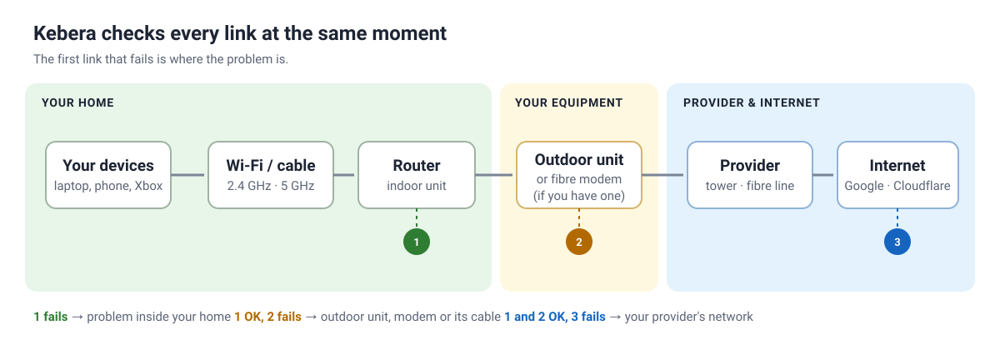
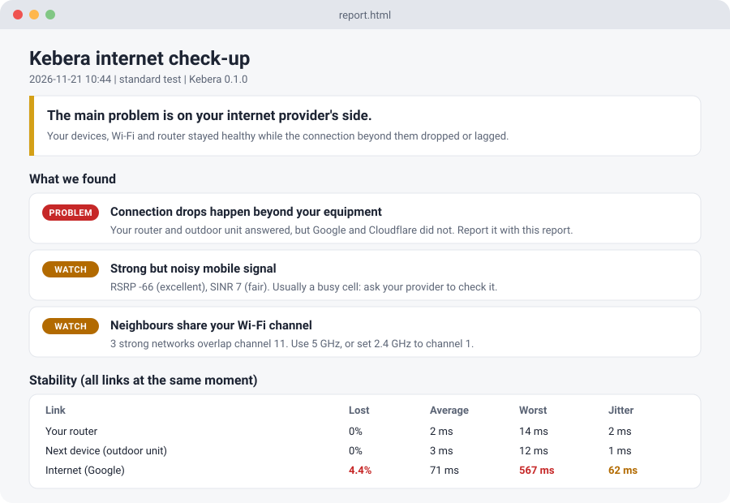

<p align="center">
  
</p>

<p align="center">
  <b>Kebera</b> (Luganda: <i>examine, inspect</i>) is a free, open-source check-up for your home internet.<br>
  It tells you <b>where</b> the problem really is (your device, your Wi-Fi, your router, your outdoor unit or fibre modem, or your internet provider) and gives you a report and a ready-to-send message for your provider.
</p>

<p align="center">
  <a href="LICENSE"></a>
  
  
  
  
</p>

<p align="center">
  🌐 <b>Website:</b> coming soon (hosted on Railway; see <a href="docs/hosting-website.md">hosting</a>) &nbsp;·&nbsp;
  📞 <a href="docs/provider-contacts.md">Provider contacts (East Africa)</a>
</p>

> [!IMPORTANT]
> **Kebera is not a hacking tool.** Use it only on **your own** internet connection
> (or one you have permission to check). You may sign in to **your own** router,
> outdoor unit or provider pages to read their status. Using Kebera on anyone else's
> network or device is not allowed. **Misuse or perversion of Kebera is not tolerated.**
> Read the [acceptable use policy](ACCEPTABLE_USE.md).

---

## Contents

1. [What is Kebera?](#1-what-is-kebera)
2. [What problems does it help with?](#2-what-problems-does-it-help-with)
3. [How it works (in one picture)](#3-how-it-works-in-one-picture)
4. [Before you start](#4-before-you-start)
5. [Choose your way to use Kebera](#5-choose-your-way-to-use-kebera)
   - [A. Free AI chat (ChatGPT, Claude, Gemini, DeepSeek…)](#a-free-ai-chat-chatgpt-claude-gemini-deepseek)
   - [B. Windows: double-click, no AI needed](#b-windows-double-click-no-ai-needed)
   - [C. AI coding agent (does most of the work)](#c-ai-coding-agent-does-most-of-the-work)
   - [D. Mac or Linux (beta)](#d-mac-or-linux-beta)
   - [E. By hand, no AI and no download](#e-by-hand-no-ai-and-no-download)
6. [Catching problems that come and go (the long log)](#6-catching-problems-that-come-and-go-the-long-log)
7. [Understanding your report](#7-understanding-your-report)
8. [Looking inside your router and outdoor unit (safely)](#8-looking-inside-your-router-and-outdoor-unit-safely)
9. [What to do next](#9-what-to-do-next)
10. [Privacy and safety](#10-privacy-and-safety)
11. [Troubleshooting](#11-troubleshooting)
12. [Frequently asked questions](#12-frequently-asked-questions)
13. [A real example](#13-a-real-example)
14. [What's in this repository](#14-whats-in-this-repository)
15. [Contributing, licence and disclaimer](#15-contributing-licence-and-disclaimer)

---

## 1. What is Kebera?

"Restart your router." "Switch it off and on again." "We'll call you back."

When your home internet is slow or keeps dropping, it's hard to prove **where** the
problem is, so the conversation with your provider goes in circles. Kebera fixes that.
It tests every part of your connection and tells you, in plain language, something like:

> **The main problem is on your internet provider's side.** Your devices, Wi-Fi and
> router stayed healthy while the connection beyond them dropped or lagged.

You also get:

- **The evidence**: simple tables with the numbers behind the verdict.
- **What you can fix yourself**, cheapest first, often free and quick.
- **A ready-to-send message** for your provider (WhatsApp or email), already filled in.

**What does it work with?** Any home internet:

- 5G or 4G home broadband with an **outdoor unit plus indoor router**
- An **indoor unit only**: a 4G/5G router with a SIM inside, no outdoor box
- **Pocket routers and MiFis**
- **Fibre** (it checks the fibre modem's light level)
- **Any Wi-Fi router** (TP-Link, Tenda, Huawei, Netgear and others)
- **Rooftop antennas** from local ISPs, and **Starlink**

It was built in Uganda (Airtel, MTN and others) but works anywhere. **No paid AI
needed.**

**Who is it for?**

| If you're… | Kebera helps you… |
|---|---|
| **Tech-savvy** | Break the problem down and diagnose it yourself: every link measured at once, signal quality, interference checks, long logs and equipment event logs. Then fix what's yours. |
| **Not tech-savvy** | Get a **clear report** your provider can't brush off, when all you hear is "restart your router", "switch it off and on" and "we'll call you back". Plus a ready message and step-by-step escalation. |

> 🧰 **Kebera doesn't replace a technician.** Some faults need hands on equipment: a
> damaged roof cable, a failing outdoor unit, a fibre fault or a problem at the tower.
> Kebera tells you **which part is failing**, so you know when to ask for a technician
> and exactly what to tell them.

**What does it cost?** Nothing. Kebera is free and open source. The optional speed
test uses about 30 MB of data.

---

## 2. What problems does it help with?

| You notice… | Kebera checks… |
|---|---|
| Internet "gives up" on all devices, then comes back | Whether the drop is in your home, at your outdoor unit/modem, or at the provider |
| It's connected but pages won't load or are very slow | Packet loss, delay spikes, DNS speed, real download/upload speed |
| Games lag, video calls freeze or robot-voice | Jitter (delay going up and down), lag spikes, where they happen |
| Only some rooms or devices are bad | Wi-Fi signal, 2.4 GHz vs 5 GHz, neighbours crowding your Wi-Fi channel |
| It's worse at certain times (evenings) | The long log records for hours and shows the worst hours |
| "Your signal is excellent," says the provider | Signal **quality** (SINR/RSRQ), not just strength, from your outdoor unit |
| Xbox or PlayStation shows "Strict NAT" | Whether your provider shares one public address between customers (CGNAT) |
| You suspect jamming or interference | Wi-Fi crowding, and the signal checks that separate a busy tower from real interference |
| The internet drops at the same time every day | The outdoor unit's logs (with your help): daily resets, power cuts, restarts |

---

## 3. How it works (in one picture)

<p align="center">
  
</p>

Your internet is a chain: **your device → Wi-Fi → router → outdoor unit or fibre modem
→ provider → internet**. Kebera checks every link of the chain **at the same moment**,
twice a second. When something goes wrong, the **first link that fails** is where the
problem is:

| If this fails first… | The problem is… | Who fixes it |
|---|---|---|
| ① Your router | Your Wi-Fi or router, inside your home | **You**, often free and quick |
| ② Your outdoor unit / fibre modem | That unit, its cable or its power | You, or the provider if the unit is faulty |
| ③ The internet (Google **and** Cloudflare) | The provider's network (tower, fibre line, congestion) | **The provider** |

Kebera checks two internet servers and only counts a failure when **both** fail at
once, so one busy website can't fool it.

---

## 4. Before you start

### What you need

- **A laptop or computer** connected to your home internet (Windows works best), **or just a phone** (using option A).
- **About 5–20 minutes.**
- **Optional:** your router's password (usually on a sticker underneath it), if you want
  to look at its signal and logs. You type it yourself; nobody else needs it.

### Know your equipment (helps, but not required)

Look at your setup and find the one that matches:

| Your setup | What it looks like | Typical in Uganda |
|---|---|---|
| **Outdoor unit + indoor router** | A box on the wall or roof outside, with a cable to a router inside | Airtel/MTN 5G and 4G home broadband |
| **Indoor 4G/5G router** | One router with a SIM card inside it | Airtel/MTN 4G routers |
| **MiFi** | A small battery-powered pocket hotspot | Mobile data on the go |
| **Fibre** | A small box with a thin white or yellow fibre cable, often plus a Wi-Fi router | Fibre providers |
| **Wireless ISP** | An antenna or dish on the roof pointed at a tower | Local ISPs |
| **Starlink** | A satellite dish | Starlink |

More detail, with diagrams: [Which connection do you have?](docs/connection-types.md)

---

## 5. Choose your way to use Kebera

| You have… | Choose | How much work |
|---|---|---|
| A **free AI chat**: ChatGPT, Claude, Gemini, DeepSeek, Copilot, Grok, Meta AI (laptop **or phone**) | **[A. Free AI chat](#a-free-ai-chat-chatgpt-claude-gemini-deepseek)** | ⭐ Easiest for most people: the AI guides you |
| A **Windows laptop** and want an instant report | **[B. Double-click](#b-windows-double-click-no-ai-needed)** | ⭐ Easy, about 5 minutes |
| A **coding agent**: Claude Code, Codex CLI, Gemini CLI, Cursor, Copilot agent mode | **[C. AI coding agent](#c-ai-coding-agent-does-most-of-the-work)** | ⭐ Least effort: the agent runs everything |
| A **Mac or Linux** computer | **[D. Mac or Linux](#d-mac-or-linux-beta)** | Easy (beta) |
| No AI and can't download anything | **[E. By hand](#e-by-hand-no-ai-and-no-download)** | About 20 minutes of copy-paste |

You can combine them. For example, run **B** for the report, then paste the report
into a free AI chat (**A**) to talk it through.

---

### A. Free AI chat (ChatGPT, Claude, Gemini, DeepSeek)

**No download, no paid plan, works on a phone too.** The AI becomes "Kebera Guide"
and walks you through every step.

**Step 1: Copy the guide**

1. Open the file [`chat/KEBERA-CHAT-GUIDE.md`](chat/KEBERA-CHAT-GUIDE.md).
2. On GitHub, click the **copy** icon at the top right of the file (it looks like two
   overlapping squares). The whole guide is now copied.
   - On a phone: tap **Raw**, then press and hold → **Select all** → **Copy**.

**Step 2: Paste it into a free AI chat**

1. Open any free AI chat: [ChatGPT](https://chatgpt.com), [Claude](https://claude.ai),
   [Gemini](https://gemini.google.com), [DeepSeek](https://chat.deepseek.com),
   Microsoft Copilot, Grok or Meta AI.
2. Start a **new chat**, paste the guide as your first message, and send it.
   - If the chat says the message is too long, **upload the file** instead and type
     *"Follow this guide."*

**Step 3: Answer its questions and follow the steps**

The AI asks four quick questions (provider, equipment, the problem, laptop or phone),
then gives you **one small step at a time**. A typical exchange looks like this:

> **Kebera Guide:** Step 1: Press the Windows key, type *PowerShell*, press Enter.
> Copy this line, right-click in the window to paste it, press Enter, and paste the
> result back here:
> `Get-NetIPConfiguration | ? IPv4DefaultGateway | % { 'Router: ' + $_.IPv4DefaultGateway.NextHop }`
>
> **You:** Router: 192.168.8.1
>
> **Kebera Guide:** Great, your router is at 192.168.8.1. Next, let's test stability…

**Step 4: Get your results**

At the end you get three things:

1. **A quick answer**: a one-line verdict, a table of what was checked, and what you can fix yourself.
2. **A detailed report**: a full document (summary, setup, every test and result,
   findings with evidence, conclusion, actions, limitations) that you can save, print
   or attach to a complaint. Say *"Yes, write the detailed report"* when it asks.
3. **A WhatsApp-ready message** for your provider, plus step-by-step help to
   escalate if they don't fix it.

**Tips**

- Before pasting or screenshotting anything, **hide** SIM numbers, IMEI, serial numbers
  and MAC addresses. The guide reminds you.
- **Never** paste a password into the chat. If a router page needs one, you type it in
  your own browser.
- Free chats have message limits. If you run out, continue later in the same chat.

---

### B. Windows: double-click, no AI needed

**Step 1: Download Kebera**

1. At the top of this page, click the green **Code** button, then **Download ZIP**.
2. Open your **Downloads** folder, right-click `kebera-main.zip`, and choose **Extract All…** → **Extract**.
3. Open the extracted **kebera-main** folder.

(If you use git: `git clone https://github.com/kazibwefrancis/Kebera.git`)

**Step 2: Run it**

1. Double-click **`kebera.bat`**.
   - If Windows shows *"Windows protected your PC"*, click **More info** → **Run anyway**.
     This appears for any downloaded script. Only do this for Kebera downloaded from
     the official page: `github.com/kazibwefrancis/Kebera`.
2. A black window opens. Type a number and press **Enter**:

   | Choose | What it does | Time | Data used |
   |---|---|---|---|
   | **1** | Standard check (recommended) | about 5 min | about 35 MB (speed test) |
   | **2** | Quick check | about 2 min | about 12 MB |
   | **3** | Long log, to catch problems that come and go ([section 6](#6-catching-problems-that-come-and-go-the-long-log)) | 3 hours | under 5 MB |

3. Keep the window open while it works. You'll see progress like this:

   ```text
   Kebera 0.1.0 - home internet check-up (read-only)
   Kebera is NOT a hacking tool. Use it only on your own connection.

   ==> Checking how this computer is connected
       Wi-Fi via Wi-Fi, router at 192.168.18.1
       Wi-Fi 'MyHome_5G', 5 GHz, channel 149, signal 87%
   ==> Scanning nearby Wi-Fi networks
       5 access points visible
   ==> Identifying your equipment (reading the pages they already show; no login)
       192.168.18.1: ZTE, MF296A, Indoor router (CPE)
       10.238.205.56: ZTE
   ==> Measuring stability at the same moment on every link (120 rounds, about 1 min)
       router     loss     0%  avg    1.8 ms  worst      6 ms  jitter   1.2 ms
       upstream   loss     0%  avg    2.5 ms  worst     10 ms  jitter   1.6 ms
       google     loss     0%  avg   43.6 ms  worst     56 ms  jitter   5.8 ms
       cloudflare loss     0%  avg   44.2 ms  worst     58 ms  jitter   6.4 ms
   ...
   ==================================================================
    VERDICT: No major problem showed up during this test.
   ==================================================================
   ```

**Step 3: Read your report**

When it finishes, the report **opens in your browser** automatically. It's also saved in
the `reports` folder inside Kebera, in a folder named with the date and time:

| File | What it's for |
|---|---|
| `report.html` | The full report. Double-click to open it in your browser. |
| `report.md` | The same report as text, easy to copy into a chat or email |
| `message-to-provider.txt` | A complaint message with your results already filled in. Add your account number and send. |
| `report.json` | All the data, for AI agents and tools |

See [section 7](#7-understanding-your-report) for how to read it.

**Advanced: run from PowerShell**

Open PowerShell in the Kebera folder (in File Explorer, click the address bar, type
`powershell`, press Enter) and run:

```powershell
powershell -ExecutionPolicy Bypass -File .\scripts\windows\kebera.ps1
```

| Option | What it does |
|---|---|
| `-Quick` | Shorter test (about 2 minutes) |
| `-NoSpeedTest` | Skip the speed test (saves data) |
| `-NoInternetServices` | Skip the speed test and the public-address check |
| `-PingRounds 300` | Longer stability test (each round is 0.5 seconds) |
| `-NoOpen` | Don't open the report automatically |
| `-OutDir C:\somewhere` | Save the report somewhere else |

Example: `powershell -ExecutionPolicy Bypass -File .\scripts\windows\kebera.ps1 -Quick -NoSpeedTest`

---

### C. AI coding agent (does most of the work)

If you have a coding agent such as **Claude Code**, **OpenAI Codex CLI**, **Gemini CLI**,
**Cursor** or **VS Code with Copilot agent mode**, it can run everything for you and
explain the results.

**Step 1:** Download Kebera (see [B, step 1](#b-windows-double-click-no-ai-needed)).

**Step 2:** Open the Kebera folder in your agent:

| Agent | How |
|---|---|
| Claude Code | Open a terminal in the Kebera folder and run `claude`, or open the folder in the Claude desktop app |
| Codex CLI | Open a terminal in the folder and run `codex` |
| Gemini CLI | Open a terminal in the folder and run `gemini` |
| Cursor / VS Code | **File → Open Folder…** → choose the Kebera folder, then open the agent chat |

**Step 3:** Type: **"Diagnose my internet."**

The agent reads [`AGENTS.md`](AGENTS.md) (Claude also reads [`CLAUDE.md`](CLAUDE.md)) and will:

1. Ask you a few questions about your provider, equipment and the problem.
2. Run the Kebera check-up and read the results.
3. If it can use a browser, open your router and outdoor unit pages. **You sign in
   yourself**; the agent never handles your passwords. It then reads the signal,
   uptime, data usage and logs.
4. Explain everything in plain language and write your message to the provider.
5. Write a **detailed report** (`kebera-full-report.md` in your report folder) that
   combines the tests, the equipment readings and logs, findings with evidence, and
   recommended actions.
6. Offer to run the long log if the problem comes and goes.

The agent instructions include strict rules: **no hacking, no password handling, no
settings changed without your clear yes.**

---

### D. Mac or Linux (beta)

1. Download Kebera (green **Code** button → **Download ZIP**, then unzip it).
2. Open **Terminal** in the Kebera folder.
3. Run:

```bash
bash scripts/unix/kebera.sh            # standard check
bash scripts/unix/kebera.sh --quick    # quick check
bash scripts/unix/kebera.sh --no-speedtest
```

Your report is saved in `reports/<date_time>/report.md`, with `message-to-provider.txt`
next to it. For best results on Linux, install `traceroute` and `dig` (package
`dnsutils` or `bind-tools`). The Mac/Linux version is newer; please report problems.

---

### E. By hand, no AI and no download

Follow **[Diagnose your internet step by step (no AI needed)](docs/step-by-step-without-ai.md)**.
It gives you each command to copy into PowerShell, and a table that tells you what the
result means. It includes:

- **The basic diagnosis** (Steps 1–7): every device or one? router address, next device,
  stability test, Wi-Fi, equipment pages
- **Going deeper** (optional): testing at the bad time, longer tests, the 3-hour log,
  repeated signal readings, the interference check, reading the equipment's logs, and
  ruling out a single device
- **Writing your detailed report** from a fill-in template, then contacting and
  escalating with your provider

---

## 6. Catching problems that come and go (the long log)

A 5-minute test can miss a problem that only happens sometimes, for example in the
evenings. The **long log** records your connection every 5 seconds for hours, then
tells you when and where things went wrong.

**How to run it**

- Double-click `kebera.bat` → choose **3** (3 hours), **or**
- In PowerShell, in the Kebera folder:

```powershell
powershell -ExecutionPolicy Bypass -File .\scripts\windows\kebera-log.ps1 -Hours 3
```

Change `-Hours 3` to any number, e.g. `-Hours 6` to cover a whole evening.

**While it runs**

- Keep the laptop **plugged in** and **awake**: *Settings → System → Power → When
  plugged in, put my device to sleep after → Never* (change it back afterwards).
- Use the internet normally. Problems often show up when it's busy.
- If something goes wrong (a game lags, a call drops), **note the time**.
- Press **Ctrl+C** to stop early. Everything recorded so far is kept.

**When it finishes** it analyses itself and saves `kebera-log_<date>-report.md` in the
`reports` folder, with:

- A verdict: where most problems happened
- Each link: losses, average, worst
- **Outages**: times when the internet was completely down for 15 seconds or more
- **Hour by hour**: which hours were worst (useful proof of evening congestion)

To analyse a log again later:

```powershell
powershell -ExecutionPolicy Bypass -File .\scripts\windows\kebera-analyze-log.ps1 -LogFile .\reports\kebera-log_2026-11-21_1044.csv
```

---

## 7. Understanding your report

<p align="center">
  
</p>

### The verdict (top of the report)

| Verdict | What it means | What to do |
|---|---|---|
| **No major problem showed up** | Everything was healthy during the test | If problems come and go, run the [long log](#6-catching-problems-that-come-and-go-the-long-log) at a bad time |
| **The main problem is inside your home** | Your Wi-Fi or router is the weak point | Follow the "What to do" tips; most are free |
| **At your outdoor unit / modem or its cable** | Home network fine, but the link to that unit is unreliable or its signal is poor | Check the cable and power adapter, look for water damage, restart the unit; contact the provider if it continues |
| **On your internet provider's side** | Your equipment was fine while the connection beyond it failed | Send `message-to-provider.txt` |
| **Both inside your home and beyond it** | More than one problem | Fix the home items first, run Kebera again, then contact the provider |

### The labels on each finding

| Label | Meaning |
|---|---|
| 🔴 **PROBLEM** | Clearly affecting your internet: fix this |
| 🟠 **WATCH** | Not great; may be part of the problem |
| 🔵 **NOTE** | Good to know, usually nothing to fix |
| 🟢 **OK** | Healthy |

### Key numbers at a glance

| Number | Good | Bad | In simple words |
|---|---|---|---|
| **Lost** (packet loss) | 0% | 2% or more | Messages that never arrived |
| **Average** (delay) to internet | under 80 ms | over 150 ms | How long a message takes to go and come back |
| **Worst** | under 150 ms | over 300 ms | The slowest moment: lag spikes |
| **Jitter** | under 10 ms | over 30–40 ms | How much the delay jumps around. Calls and games hate it. |
| **Wi-Fi signal** | 70%+ | under 40% | How well your device hears the router |
| **RSRP** (outdoor unit/4G router) | −90 or better | below −100 | Mobile signal **strength** |
| **SINR** | 13 or more | below 5 | Mobile signal **quality**: noise and congestion |
| **Download speed** | matches your plan | under 5 Mbps | How fast things download |

Full explanations: [Interpreting the results](docs/interpreting-results.md).

> 💡 **"Strong signal but poor quality"** (good RSRP, low SINR) usually means a **busy
> tower** or interference, which is the provider's problem, even if they say "your
> signal is excellent". See [Interference and jamming](docs/interference-and-jamming.md).

---

## 8. Looking inside your router and outdoor unit (safely)

Your equipment has its own web pages with the most useful information: signal
quality, how long it has stayed connected, data used this month, and logs of drops
and restarts.

**How to open them**

1. Find the address: it's in your Kebera report under **"Your setup"** (e.g.
   `192.168.8.1` for the router, and a second address for an outdoor unit).
2. Type it into your browser's address bar, e.g. `http://192.168.8.1`.
   - A **certificate warning** is normal for home equipment.
3. **Sign in yourself.** The password is usually on a sticker under the device, unless
   it was changed. Never give it to anyone else, including AI chats.

**What to look at** (menu names vary by make)

| Page | What you'll find |
|---|---|
| **Device information / Network information / Signal** | RSRP, RSRQ, SINR, RSSI for 4G and 5G; band; cell ID |
| **Home / Status** | Connection time: if it keeps resetting, the connection is dropping |
| **Data usage / Statistics** | Data used this month: useful when asking about fair-usage limits |
| **Logs** (e.g. ZTE: *System Settings → Key Log Information*) | A week of drops, restarts and signal history |
| **Fibre modem: Optical / PON info** | Light level (Rx power): below −27 dBm means a fibre problem |

> ⚠️ **Look, don't touch.** Don't press **Restart**, **Reset**, or change the APN,
> network mode or firmware unless you know exactly why. Reset can wipe your settings.

Guides for specific equipment: [ZTE](docs/devices/zte.md) ·
[Huawei](docs/devices/huawei.md) · [Fibre modems](docs/devices/fibre-onts.md) ·
[Other routers and antennas](docs/devices/other-routers.md)

---

## 9. What to do next

### Things you can fix yourself (free or cheap)

| Problem found | Fix |
|---|---|
| Weak Wi-Fi signal | Move closer to the router, put the router higher and more central, or use a cable |
| Device on 2.4 GHz near the router | Connect to your router's **5 GHz** network (often named with `_5G`) |
| Neighbours crowding your Wi-Fi | Use 5 GHz; set 2.4 GHz to channel 1, 6 or 11 (whichever Kebera suggests) |
| Slow DNS | Set DNS to `1.1.1.1` and `8.8.8.8` on the device or router |
| Weak mobile signal (indoor router) | Move the router to a window, as high as possible, away from metal |
| Restarts during power cuts | A small **UPS** for the router and outdoor unit keeps you online for hours |
| Game console far from router | Use a network cable |

### Your detailed report

For a complete document to keep and attach to complaints, use the
[detailed report template](templates/diagnosis-report.md). It has 8 sections: summary,
the problem, setup, tests and results, findings with evidence, conclusion, actions,
and limitations.

- **Free AI chat:** the guide writes it for you at the end.
- **Coding agent:** it saves `kebera-full-report.md` in your report folder.
- **By hand:** copy the template and fill in your results.

### Contacting your provider

1. Open `message-to-provider.txt` from your report folder.
2. Add your **account or line number**, name and area.
3. Send it by WhatsApp, email or the provider's app. Most Ugandan providers answer on WhatsApp.
   Customer care numbers for Uganda, Kenya, Tanzania and Rwanda: [provider contacts](docs/provider-contacts.md).
4. **Always ask for a reference number**, and note the date and the agent's name.

More templates: [WhatsApp](templates/message-whatsapp.md) · [Email](templates/message-email.md).
How to answer "restart your router" and other common replies:
[Working with your provider](docs/providers.md).

### Not resolved?

Escalate **step by step with your provider**: follow up in the same chat, ask for
the technical team, then a supervisor, visit a service centre, and finally send a
formal written complaint with your detailed report. Each step is explained, with
ready wording, in [How to escalate](templates/escalation.md).

---

## 10. Privacy and safety

**Safe by design**

- **Read-only.** Kebera never changes settings, never logs in, never guesses passwords,
  never installs anything.
- **Your equipment only.** It finds your own router and the device behind it
  automatically, and has **no option to aim it at anything else**. A built-in safety
  check stops the script if any target isn't your own local equipment or one of two
  fixed public test servers.
- **Visible safeguards, not hidden ones.** The rules are written in plain view in every
  script. Download Kebera **only** from `github.com/kazibwefrancis/Kebera`; copies
  elsewhere may have been changed.

**Private**

- Everything runs and stays on your computer. There's no Kebera server or account.
- Reports **leave out** neighbours' Wi-Fi names, MAC addresses, SIM/IMEI numbers,
  passwords and your full public IP address.
- Outside services contacted: Google and Cloudflare (pings and name lookups),
  `api.ipify.org` (public-address check) and `speed.cloudflare.com` (speed test).
  The last two can be turned off.

Full details: [PRIVACY.md](PRIVACY.md) · [ACCEPTABLE_USE.md](ACCEPTABLE_USE.md) ·
[DISCLAIMER.md](DISCLAIMER.md)

---

## 11. Troubleshooting

| Problem | Solution |
|---|---|
| *"Windows protected your PC"* | Click **More info → Run anyway** (only for Kebera from the official page). |
| *"Running scripts is disabled on this system"* | Use `kebera.bat`, or the full command with `-ExecutionPolicy Bypass`. It applies only to that run and doesn't change your settings. |
| The window opens and closes immediately | Right-click `kebera.bat` → **Edit** to check it's intact, or run the PowerShell command from section B to see the error. |
| *"No active network connection was found"* | Connect to your Wi-Fi or plug in the cable, then try again. |
| *"0 access points visible"* / no Wi-Fi list | Windows 11: *Settings → Privacy & security → Location* → turn **Location services** on (Windows needs it for Wi-Fi scanning). |
| My router wasn't identified | Check the label under it for the make and model. The report still works; please [send a device report](../../issues/new?template=device-report.md). |
| Speed test shows nothing | The speed test server may be blocked or your data finished. Run with `-NoSpeedTest`. |
| Antivirus warns about the script | Kebera is plain, readable text. You can open any `.ps1` file in Notepad and read it. Allow it only if you downloaded it from the official page. |
| Windows isn't in English | Wi-Fi details are read from English Windows output, so some may be missing. Pings, route, DNS and speed still work. Translations welcome. |
| The laptop went to sleep during the long log | Set sleep to **Never** while plugged in (section 6). The log keeps what it recorded; start it again. |
| Router page says "login" and the AI agent stopped | That's on purpose. Sign in yourself, then tell the agent you're done. |

---

## 12. Frequently asked questions

**Do I need a paid AI?**
No. Use the [free chat guide](chat/KEBERA-CHAT-GUIDE.md) with any free AI chat, double-click
`kebera.bat`, or follow the [no-AI guide](docs/step-by-step-without-ai.md). A paid coding
agent just does more of the steps for you.

**Can I use only my phone?**
Yes, partly. Use option A: the chat guide has a phone-only path covering router pages,
signal readings, a speed test, and comparing Wi-Fi with mobile data.

**Will it change anything on my router?**
No. Kebera is read-only. If you later decide to change something, such as your Wi-Fi
channel, you do it yourself, knowing how to undo it.

**How much data does it use?**
About 35 MB for the standard check, 12 MB for quick, under 1 MB with `-NoSpeedTest`.
The long log uses only a few MB over 3 hours.

**Is it legal?**
Yes, on **your own** connection. Kebera does what your computer and browser already do
(pings, opening your router's page). Using it on other people's networks is not allowed;
see [ACCEPTABLE_USE.md](ACCEPTABLE_USE.md).

**Does it work with Airtel, MTN, Lyca, fibre, Starlink…?**
Yes. Kebera tests the connection itself, so it works with any provider. It recognises
ZTE and Huawei equipment (common with Airtel and MTN) most completely, and others by
their web page.

**Can Kebera prove my provider is at fault?**
It gives you **strong evidence** of where the problem is during the test. It isn't a
certified measurement or legal proof, but it turns "my internet is bad" into specific
facts that are hard to dismiss.

**My result says "no major problem" but my internet is still bad. Why?**
The problem probably comes and goes. Run the [long log](#6-catching-problems-that-come-and-go-the-long-log)
for a few hours including an evening, or run Kebera again at a bad moment.

**Can I share my report?**
Yes. Reports leave out private identifiers. Read it once before sharing anyway.

**What does "Kebera" mean?**
*Examine* or *inspect* in Luganda.

---

## 13. A real example

The case that started Kebera, in Kampala, November 2026:

> *"My Xbox, my laptop, my phone: sometimes the internet just gives up. It started
> with the router."*

| Check | Result |
|---|---|
| Xbox, laptop, phone, indoor router | ✅ Healthy |
| Outdoor 5G unit and its cable | ✅ Healthy: 0 lost out of 350 stress tests |
| 5G signal | ✅ Strong and clean |
| 4G "anchor" signal (5G depends on it) | ❌ Strong but noisy: quality 6 dB on average all week, down to −5 dB |
| Interference check | ✅ No jamming: a busy tower |
| Outdoor unit logs | Connection reset about every 24 hours; restarts matched power cuts |
| Wi-Fi | ⚠️ Crowded 2.4 GHz channel. Moving to 5 GHz cut the laptop's delay to the router from up to 58 ms to about 2 ms. |

**Verdict:** the equipment was fine. The lag came from the provider's busy 4G cell,
the short daily drops from a 24-hour session reset, and the longer outages from power
cuts. [Read the full case study](examples/case-study-kampala-5g.md).

---

## 14. What's in this repository

```text
kebera/
├── kebera.bat                  ← Double-click this on Windows
├── chat/
│   └── KEBERA-CHAT-GUIDE.md    ← Paste into any free AI chat
├── scripts/
│   ├── windows/
│   │   ├── kebera.ps1              ← Main check-up
│   │   ├── kebera-log.ps1          ← Long log
│   │   └── kebera-analyze-log.ps1  ← Analyses a long log
│   └── unix/
│       └── kebera.sh               ← Mac and Linux check-up (beta)
├── docs/
│   ├── step-by-step-without-ai.md  ← Manual guide
│   ├── interpreting-results.md     ← What every number means
│   ├── connection-types.md         ← Which setup do you have?
│   ├── interference-and-jamming.md
│   ├── providers.md                ← Working with your provider
│   └── devices/                    ← ZTE, Huawei, fibre, other equipment
├── templates/                  ← Detailed report, WhatsApp, email and escalation guide
├── deploy/ · railway.json      ← Hosting the website on Railway
├── site/                       ← The project website
│   ├── index.html
│   └── providers.json          ← East African customer care contacts
├── examples/                   ← Real, anonymised case studies
├── AGENTS.md                   ← Instructions for AI coding agents
├── CLAUDE.md                   ← Strict rules for Claude
├── ACCEPTABLE_USE.md           ← Not a hacking tool: the rules, and the laws
├── PRIVACY.md · DISCLAIMER.md · SECURITY.md
├── CONTRIBUTING.md · CODE_OF_CONDUCT.md · CHANGELOG.md
└── LICENSE                     ← MIT
```

Your own results go into `reports/`, which stays on your computer and is never uploaded.

---

## 15. Contributing, licence and disclaimer

**Help make Kebera better.** Every router, outdoor unit and fibre modem that people report
makes the next diagnosis better. Especially welcome:

- **Device reports**: [open one here](../../issues/new?template=device-report.md), with identifiers removed
- **Translations**: Luganda, Swahili, Runyankole, Acholi, Lusoga and others
- **Testing on Mac and Linux**
- **Real cases**, anonymised

See [CONTRIBUTING.md](CONTRIBUTING.md). Only the maintainer merges changes into this
repository, and anything that weakens Kebera's safeguards will be rejected.

**Licence:** [MIT](LICENSE) © 2026 Kazibwe Francis. Anyone may use, copy, modify and share
Kebera. Use within the Kebera project is governed by the
[acceptable use policy](ACCEPTABLE_USE.md).

**Disclaimer:** Kebera is independent and **not affiliated with** Airtel, MTN, Lyca, Roke
Telkom, Starlink, ZTE, Huawei or any other company mentioned; names are used only to
identify equipment and services. Results describe the moment of the test and are provided
"as is", without warranty. See [DISCLAIMER.md](DISCLAIMER.md).

<p align="center"><b>Kebera</b>: examine your connection, know the facts, get it fixed.</p>
